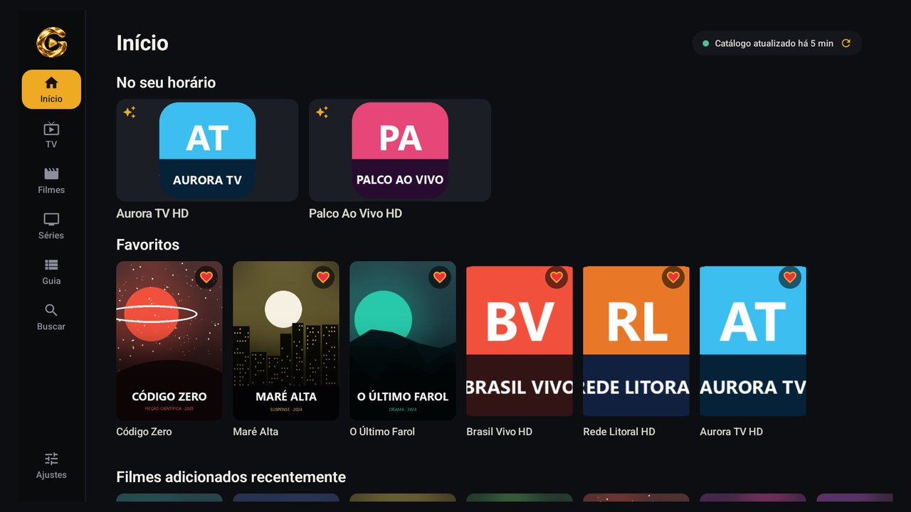
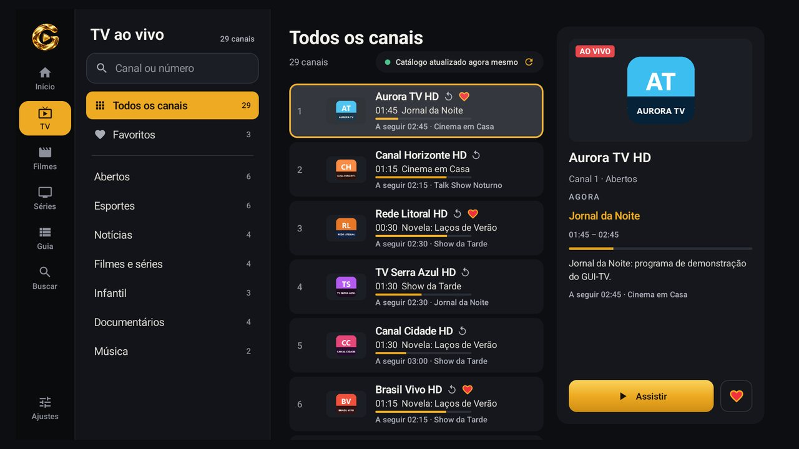
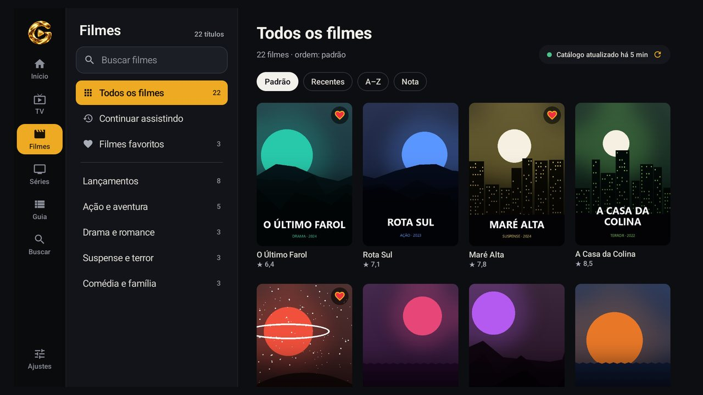
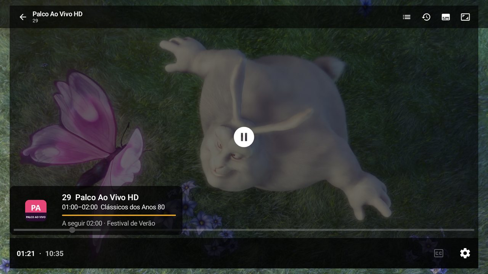
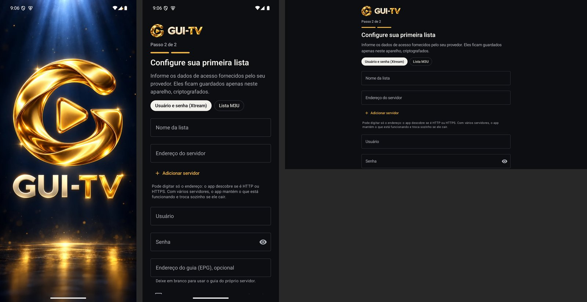

<div align="center">


# GUI-TV

**Player IPTV para Android TV, TV Box, celular e tablet.**
Rápido, leve e feito para o controle remoto.

[](https://github.com/guigallina27/GUI-TV/releases/latest/download/GUI-TV.apk)
[](#requisitos)
[](#por-que-é-tão-leve)


</div>

---

## Novidades da versão 1.1.3

- ♻️ **Lista excluída não perde mais nada:** favoritos, progresso e histórico ficam guardados por **90 dias**. Dá para restaurar a lista inteira em *Minhas listas* ou pelo botão **Restaurar lista excluída**, sem digitar nada de novo.
- 🔁 **Restauração inteligente:** ao cadastrar de novo a mesma lista (mesmos servidores, usuário e senha), o app pergunta se você quer trazer os dados de volta.
- 💬 **Mensagens de erro simples**, como *"Endereço não encontrado"* ou *"Usuário ou senha incorretos"*, com um **código curto** (por exemplo, `E-11`) para informar ao suporte.
- 🖧 **Resultado de cada servidor:** em listas com vários endereços, o app mostra qual está respondendo e qual falhou, e por quê.
- 🧯 **Fechamentos inesperados** geram um código (por exemplo, `F-1A2B3C`) e um relatório técnico em *Ajustes › Diagnóstico*, para facilitar o suporte.
- 📺 Séries voltam ao topo da lista ao trocar de temporada, e o controle remoto não fica mais preso nos campos de texto.
- 📡 Canais ao vivo reconectam sozinhos quando o servidor encerra a transmissão, e o guia de programação não é mais apagado por uma atualização incompleta.
- 🛠️ Novo seletor de tipo de lista, TVs só com cabo de rede são aceitas, e várias correções de estabilidade.

<details>
<summary><b>Versão 1.1.2</b></summary>

- 🩺 **Teste de desempenho completo:** processador, memória, fluidez, formatos de vídeo, internet, Wi-Fi e a **velocidade real de entrega do servidor da sua lista**, com medição ao vivo na tela.
- 🌐 **DNS desta lista:** em *Minhas listas*, veja quais DNS (do aparelho, Google, Cloudflare, OpenDNS e Quad9) encontram o servidor e em quantos milissegundos.
- 🖥️ **Margem da tela ajustável** para TVs que cortam as bordas, e interface no tamanho certo com foco bem visível.
- ↔️ **Esticar** e detecção automática de **faixas pretas**, lembrados por episódio.
- ⏭️ **Pular créditos finais** por série, aprendendo onde cada uma termina.
- ❤️ Coração de favorito mais visível e ajustes de reprodução organizados por assunto.
- 🛠️ Corrige o app fechando ao cadastrar a lista em algumas TV Boxes.

</details>

---

## Sumário

- [Novidades da versão 1.1.3](#novidades-da-versão-113)
- [Instalação rápida](#instalação-rápida)
- [Como instalar na TV](#como-instalar-na-tv)
- [Como instalar no celular](#como-instalar-no-celular)
- [Primeiro uso](#primeiro-uso)
- [Funcionalidades](#funcionalidades)
- [Telas](#telas)
- [Teste de desempenho](#teste-de-desempenho)
- [Requisitos](#requisitos)
- [Privacidade e segurança](#privacidade-e-segurança)
- [Por que é tão leve](#por-que-é-tão-leve)
- [Atualizações](#atualizações)
- [Verificar o arquivo](#verificar-o-arquivo)
- [Problemas comuns](#problemas-comuns)
- [Aviso importante](#aviso-importante)

---

## Instalação rápida

| Onde | O que digitar ou abrir |
|---|---|
| **Downloader (TV)** | Código **`6504169`** ou o endereço `is.gd/guitvapk` |
| **Navegador (celular)** | [is.gd/guitvapk](https://is.gd/guitvapk) |
| **Link direto** | `https://github.com/guigallina27/GUI-TV/releases/latest/download/GUI-TV.apk` |

> Os links apontam sempre para a **versão mais recente**: quando sair uma atualização, os mesmos endereços já baixam a versão nova.

---

## Como instalar na TV

Vale para Android TV, Google TV, TV Box e Fire TV.

1. Na loja da TV (Play Store ou Amazon Appstore), instale o app **Downloader** (da AFTVnews).
2. Abra o Downloader. Se ele pedir, permita o acesso a arquivos.
3. No campo de endereço, digite o código **`6504169`** e confirme em **Go**. Se preferir, digite o endereço **`is.gd/guitvapk`**.
4. Na primeira vez, o Android avisa que o Downloader não pode instalar apps. Toque em **Configurações**, ative **Permitir desta fonte** e volte.
5. Toque em **Instalar** e depois em **Abrir**.
6. Depois de instalado, o Downloader oferece apagar o APK baixado. Pode apagar para liberar espaço.

<details>
<summary><b>Outras formas de instalar na TV</b></summary>

**Pendrive**
1. Baixe o `GUI-TV.apk` no computador e copie para um pendrive.
2. Conecte o pendrive na TV e abra o arquivo com um gerenciador de arquivos (por exemplo, X-plore ou FX File Explorer).

**ADB pela rede (para quem já usa)**
1. Na TV, ative as **Opções do desenvolvedor** (toque 7 vezes em *Configurações › Sobre › Build*) e ligue a **Depuração por rede**.
2. No computador:
   ```bash
   adb connect IP_DA_TV:5555
   adb install -r GUI-TV.apk
   ```

</details>

---

## Como instalar no celular

1. No celular, abra **[is.gd/guitvapk](https://is.gd/guitvapk)** no navegador.
2. Abra o arquivo baixado e, se o Android pedir, permita que o navegador instale apps.
3. Toque em **Instalar**.

> O Play Protect pode mostrar um aviso porque o app não vem da Play Store. Isso é normal para apps instalados por fora. Toque em **Mais detalhes › Instalar mesmo assim**.

---

## Primeiro uso

1. Escolha o idioma: português, inglês, espanhol ou o idioma do aparelho.
2. Cadastre a sua lista com os dados que o **seu provedor** forneceu:
   - **Usuário e senha (Xtream Codes):** endereço do servidor, usuário e senha. Pode digitar só o endereço (`painel.exemplo.com:8080`): o app descobre sozinho se o servidor usa HTTP ou HTTPS.
   - **Lista M3U:** link da lista ou arquivo `.m3u` do aparelho.
3. Pronto. O catálogo baixa em segundos e passa a se atualizar sozinho em segundo plano.

> Tem mais de um endereço de servidor? Toque em **Adicionar servidor**. O app usa o mais rápido e troca sozinho se ele cair.

---

## Funcionalidades

**TV ao vivo**
- Troca de canal pelas setas, por **CH+ / CH−** ou digitando o número no controle.
- Volta ao canal anterior, lista lateral de canais e mini-guia sem sair do vídeo.
- Guia de programação (EPG) em grade, com **catch-up** nos canais que oferecem arquivo.
- Casamento automático do guia com os canais, mesmo em listas M3U.

**Filmes e séries**
- Capa, sinopse, elenco, nota e ano.
- Temporadas e episódios em ordem, com o código **T1 · E1** em destaque.
- Continuar de onde parou, começar do início ou marcar como assistido.
- Próximo episódio automático, com contagem regressiva.
- Reprodução aleatória de episódios.

**Player**
- Faixas de áudio e legenda, proporção da tela e velocidade nos filmes e séries.
- **Esticar** e detecção automática de **faixas pretas**, salvos por episódio.
- **Pular créditos finais**, aprendendo o ponto de cada série.
- Reconexão automática quando o sinal cai, troca de formato (TS ↔ HLS) e de servidor.
- Áudio AC3, E-AC3, DTS e TrueHD decodificado no próprio app, mesmo em aparelhos sem suporte.
- Controles na notificação e na tela de bloqueio, e **Picture-in-Picture** no celular.
- Diagnóstico **"por que não toca?"** com detalhes técnicos, sem mostrar a sua senha.

**Conexão**
- **DNS público por HTTPS** (Google, Cloudflare, OpenDNS e Quad9): acha o servidor da sua lista mesmo quando a operadora não encontra ou bloqueia o endereço. Dá para escolher um deles ou usar o DNS do aparelho.
- Vários servidores na mesma lista, com troca automática para o mais rápido.
- Ao cadastrar, o resultado de **cada servidor** (respondendo ou com o motivo da falha) e um **código de erro** curto para o suporte.
- Em **Minhas listas**, o estado de cada servidor e o bloco **DNS desta lista**, com o tempo de resposta de cada DNS.

**Teste de desempenho**
- Avalia o aparelho, a internet e o servidor da lista e diz se dá conta de HD, Full HD ou 4K. Detalhes em [Teste de desempenho](#teste-de-desempenho).

**Atualização automática**
- O app avisa quando sai versão nova, baixa, confere a assinatura e instala. Sem precisar baixar nada pelo Downloader de novo.

**Organização**
- Vários perfis, cada um com favoritos (marcados com ❤️ nas capas e na lista de canais), histórico e progresso próprios.
- Perfil infantil e **controle parental com PIN**, bloqueio por categoria e conteúdo adulto oculto por padrão.
- Busca em tudo (canais, filmes, séries e programação), tolerante a acentos e erros de digitação, inclusive por voz.
- Várias listas no mesmo aparelho.
- **Lista excluída guardada por 90 dias:** restaure a lista inteira (servidores, usuário, senha, favoritos e progresso) em *Minhas listas*, ou deixe o app reconhecer quando a mesma lista for cadastrada de novo.

**Feito para TV**
- Navegação completa pelo controle remoto, com foco sempre visível.
- Interface que se adapta a TV, tablet e celular, inclusive em telas pequenas e com fonte grande.
- **Margem da tela ajustável** para TVs que cortam as bordas da imagem.
- Ajustes de reprodução separados por assunto: vídeo, áudio e legendas, tela, internet e guia.

---

## Telas

<table>
<tr>
<td width="50%"><br><sub><b>Início:</b> sugestões do horário, favoritos e novidades</sub></td>
<td width="50%"><br><sub><b>TV ao vivo:</b> categorias, programação atual e a seguir</sub></td>
</tr>
<tr>
<td width="50%"><br><sub><b>Filmes:</b> categorias, ordenação e favoritos</sub></td>
<td width="50%"><br><sub><b>Player:</b> mini-guia do canal sem sair do vídeo</sub></td>
</tr>
</table>

<sub>Telas capturadas com uma lista de demonstração: canais, filmes e programação são fictícios. Vídeo: <i>Big Buck Bunny</i> © Blender Foundation, licença CC BY 3.0.</sub>

<div align="center">

<br>


&nbsp;


<sub>Abertura na TV e no celular</sub>

<br><br>



<sub>Abertura e cadastro da lista no celular e na TV</sub>

<br><br>


<sub>Banner na tela inicial da Android TV</sub>

</div>

---

## Teste de desempenho

Em **Ajustes › Desempenho do aparelho**, o GUI-TV mede em cerca de 40 segundos tudo o que influencia a reprodução e mostra o resultado em linguagem simples:

| Etapa | O que mede |
|---|---|
| Aparelho | Processador, memória, armazenamento e fluidez da tela |
| Formatos | Quais formatos de vídeo e áudio o aparelho decodifica por hardware |
| Internet | Download e upload ao vivo, com o **pior segundo** da medição para revelar oscilações |
| Wi-Fi | Banda (2,4 ou 5 GHz) e velocidade do link com o roteador |
| Servidores da lista | Tempo de resposta de cada servidor (DNS) cadastrado |
| Entrega do servidor | Quantos Mbps o servidor da **sua lista** entrega de verdade e quanto demora para o vídeo começar |

No fim, o app indica a qualidade máxima recomendada e aponta o gargalo, por exemplo: *"o servidor da lista entregou só 8 Mbps, bem abaixo da sua internet: o gargalo é o provedor"*. O último resultado fica salvo para comparar depois.

> O teste usa até 250 MB de internet. Em dados móveis, o app avisa antes de começar.

---

## Requisitos

| Item | Mínimo |
|---|---|
| Sistema | Android 6.0 (Marshmallow) ou mais novo |
| Aparelhos | Android TV, Google TV, TV Box, Fire TV, celular e tablet |
| Processador | ARM 32/64 bits ou x86 (inclui emuladores) |
| Espaço | Download de ~11 MB, mais o catálogo da sua lista |
| Internet | Conexão estável; para 4K, recomenda-se 25 Mbps ou mais |
| Conteúdo | Uma lista **Xtream Codes** ou **M3U** do seu provedor |

---

## Privacidade e segurança

- **Sem cadastro, sem anúncios e sem rastreamento.** O app não envia estatísticas de uso para ninguém.
- **Usuário e senha ficam só no aparelho**, criptografados com a chave segura do Android (Keystore).
- **HTTPS por padrão.** Conexão sem criptografia só com a sua permissão, lista por lista.
- **PIN do controle parental protegido** e com bloqueio após tentativas erradas.
- Mensagens de erro e detalhes técnicos **nunca mostram usuário nem senha**.
- Relatórios de fechamento inesperado e backups de listas excluídas **ficam só no aparelho**: nada é enviado para fora.

---

## Por que é tão leve

O APK tem cerca de **11 MB**, contra 90 MB ou mais de players comuns:

- O vídeo é decodificado pelo **chip do próprio aparelho** (Media3 / ExoPlayer), sem embutir um FFmpeg completo; do FFmpeg, só os decodificadores de áudio.
- Não carrega VPN, banco de dados nativo nem bibliotecas que não usa.
- Imagens otimizadas e código enxuto.

Resultado: instala rápido, ocupa pouco espaço e a atualização do catálogo leva segundos, sem travar a tela.

---

## Atualizações

A partir da versão **1.1.0**, o GUI-TV **se atualiza sozinho**:

1. Na primeira abertura do dia (e a cada 12 horas), ele verifica se saiu versão nova. Na primeira execução, a verificação acontece antes do cadastro da lista.
2. Aparece o aviso **Nova versão disponível**, com as novidades. Toque em **Atualizar agora**.
3. O app baixa o arquivo e confere se é uma versão oficial (SHA-256 e assinatura). Arquivo diferente é descartado.
4. **Só na primeira vez**, o Android pede para permitir que o GUI-TV instale apps: ative **Permitir desta fonte** e volte ao app. A instalação continua sozinha.
5. Confirme em **Instalar**. Listas, perfis, favoritos e progresso são mantidos.

> No Android 6 e 7, a permissão é a mesma "Fontes desconhecidas" usada para instalar o app, então normalmente não aparece nada.
> No Android 12 ou mais novo, a partir da segunda atualização feita pelo próprio app, a instalação pode acontecer sem confirmação.

A verificação automática pode ser desligada em **Ajustes › Sobre › Atualizações**, onde também fica o botão **Verificar atualizações**.

Quem preferir pode atualizar como na instalação: baixe pelo mesmo link e instale **por cima**. Todas as versões são assinadas com a **mesma chave**; se o Android recusar, a versão instalada veio de outra fonte: desinstale e instale de novo.

O histórico de versões fica em [Releases](https://github.com/guigallina27/GUI-TV/releases).

<details>
<summary><b>Para quem instala TV Boxes para clientes</b></summary>

Depois de instalar pelo ADB, libere a atualização automática de uma vez para o cliente nem ver o pedido de permissão:

```bash
adb shell appops set br.com.iptvplayer.v2 REQUEST_INSTALL_PACKAGES allow
```

</details>

---

## Verificar o arquivo

Para conferir se o APK baixado é o original:

| Item | Onde encontrar |
|---|---|
| SHA-256 do APK | Nas notas de cada [release](https://github.com/guigallina27/GUI-TV/releases) e no arquivo `GUI-TV.apk.sha256` |
| Certificado | `CN=GUI-TV` |
| SHA-256 do certificado | `7645d3a81ccd73d07408f82d79c92d367590545830b302c786fc4290dc7d7193` (o mesmo em todas as versões) |

```bash
# Windows (PowerShell)
Get-FileHash GUI-TV.apk -Algorithm SHA256

# Linux / macOS
sha256sum GUI-TV.apk
```

---

## Problemas comuns

<details>
<summary><b>"App não instalado" ou "pacote inválido"</b></summary>

- Já existe uma versão do GUI-TV assinada com outra chave. Desinstale e instale de novo.
- O download ficou incompleto. Baixe de novo e confira o SHA-256.
</details>

<details>
<summary><b>O Downloader não abre o link</b></summary>

- Digite o código `6504169` ou o endereço exatamente como está: `is.gd/guitvapk`.
- Se a rede bloquear encurtadores, use o link direto do GitHub, na tabela de [Instalação rápida](#instalação-rápida).
</details>

<details>
<summary><b>Não consigo entrar com a minha lista</b></summary>

- O app mostra o motivo em palavras simples (usuário ou senha incorretos, conta expirada, endereço não encontrado, servidor fora do ar e outros) e um **código de erro**, como `E-30`. Informe esse código ao suporte.
- Com vários servidores, a lista **Resultado de cada servidor** mostra qual respondeu e qual falhou. Os **Detalhes técnicos** trazem a resposta completa, sem usuário nem senha.
- Confira os dados com o seu provedor. Senhas diferenciam maiúsculas e minúsculas.
- Se aparecer **servidor não encontrado**, a operadora pode estar bloqueando o endereço. Em **Ajustes › Reprodução e preferências › DNS**, deixe em **Automático** ou escolha **Google** ou **Cloudflare**.
</details>

<details>
<summary><b>A atualização automática não instala</b></summary>

- Confira se o GUI-TV tem a permissão **Instalar apps desconhecidos** (Configurações › Apps › GUI-TV, ou Segurança › Fontes desconhecidas).
- O aviso de erro mostra o motivo e um detalhe técnico. Se persistir, baixe pelo link `is.gd/guitvapk` e instale por cima.
</details>

<details>
<summary><b>Um canal não toca</b></summary>

- Use **"Por que não toca?"** no player: o app aponta se o problema é o canal, o servidor, a conta ou o formato.
- Aparelhos muito antigos podem não ter decodificador para alguns formatos de vídeo (por exemplo, HEVC/H.265).
</details>

<details>
<summary><b>Os canais ou filmes travam</b></summary>

- Rode o teste em **Ajustes › Desempenho do aparelho**: ele mostra se o problema é o aparelho, o Wi-Fi, a internet ou o servidor da lista.
- Wi-Fi em 2,4 GHz ou longe do roteador costuma causar travadas. Se possível, use a rede de 5 GHz ou cabo de rede.
- Em **Minhas listas**, confira no bloco **DNS desta lista** se algum DNS responde mais rápido e escolha-o em **Ajustes › Reprodução e preferências › Internet**.
</details>

<details>
<summary><b>Apaguei uma lista sem querer</b></summary>

- Em **Ajustes › Listas**, a seção **Listas excluídas** mostra as listas removidas nos últimos 90 dias. Escolha a lista e toque em **Restaurar**: ela volta com servidores, usuário, senha, favoritos e progresso.
- No cadastro de uma lista nova, o botão **Restaurar lista excluída** faz o mesmo.
</details>

<details>
<summary><b>O app fechou sozinho</b></summary>

- Na abertura seguinte, o GUI-TV mostra um **código** (por exemplo, `F-1A2B3C`). Informe esse código ao suporte.
- Os últimos fechamentos ficam em **Ajustes › Diagnóstico › Fechamentos inesperados**, com os detalhes técnicos. No celular, dá para **compartilhar** o relatório.
</details>

<details>
<summary><b>A imagem fica cortada nas bordas</b></summary>

- Algumas TVs ampliam a imagem e cortam as bordas. Ajuste a **Margem da tela** em **Ajustes › Reprodução e preferências › Aplicativo e tela**.
</details>

---

## Aviso importante

O **GUI-TV é apenas um reprodutor**. Ele **não fornece, não vende e não hospeda** nenhum canal, filme, série ou lista.
Para usar, é preciso ter uma lista própria fornecida por um provedor. O uso do conteúdo é de responsabilidade de quem o acessa;
use somente listas que você tem direito de assistir.

<div align="center">
<br>
<sub>GUI-TV · Android 6.0+ · Feito para a sala de TV</sub>
</div>
